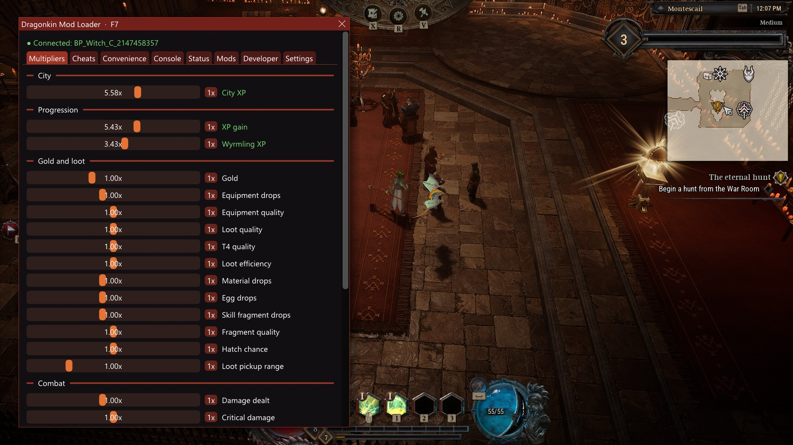

# Dragonkin Mod Loader + Dragonkin Plus

Source code of two mods for **Dragonkin: The Banished** (Unreal Engine 5.5, Windows).
Türkçe: [README_TR.md](README_TR.md).

| | Download | What it is |
|---|---|---|
| **Dragonkin Mod Loader** | [Nexus Mods](https://www.nexusmods.com/dragonkinthebanished/mods/11) | `dwmapi.dll`: in-game mod menu (F7), mod loader for `mod.json` mods and native plugins |
| **Dragonkin Plus** | [Nexus Mods](https://www.nexusmods.com/dragonkinthebanished/mods/12) | plugin of the loader: multipliers, cheats, quality of life (5 panel tabs) |

Players: download from Nexus; install and usage are explained there and in
[release/loader/README.md](release/loader/README.md) / [release/plus/README.md](release/plus/README.md).
Mod makers: [docs/MODDING.md](docs/MODDING.md) and [sdk/dml_plugin.h](sdk/dml_plugin.h).

## How it works
* **No other tools.** `dwmapi.dll` is a proxy of the system DLL (forwarders in `src/exports.h`)
  that the game loads from its own folder.
* **Own Unreal reflection** (`src/ue.cpp`): finds GObjects/GNames, walks classes and
  properties at runtime and calls UFunctions through `ProcessEvent`. Offsets are discovered,
  not hard-coded per build.
* **Panel** (`src/overlay.cpp`): a separate top-most, non-activating window with its own
  D3D11 device and Dear ImGui. The game's renderer is never hooked, the panel never takes
  focus and follows the game's monitor in windowed and fullscreen mode.
* **Game thread**: work is done in a message posted to the game window, so every UObject
  access happens on the thread that owns it.
* **Mod loader** (`src/modloader.cpp`): reads `Mods/<folder>/mod.json`, validates it with
  line numbers, keeps one shared value registry (set / add / multiply, keyed by address)
  so mods never overwrite each other and switching a mod off restores the game's value.
  Native plugins (API in `sdk/dml_plugin.h`) load only after "Allow native code" and are
  switched off after repeated crashes.
* **Languages** (`src/i18n.cpp`): English, Türkçe, Français, Deutsch, العربية (with shaping),
  繁體中文, 简体中文.

## Build
Visual Studio 2022+ with the C++ workload, then run `build.bat`:

| Output | |
|---|---|
| `build\dwmapi.dll` | Mod Loader |
| `build\plus\DragonkinPlus.dll` | Dragonkin Plus plugin |
| `build\plugin\ExamplePlugin.dll` | SDK example |

`python tools/package.py` builds both release zips in `dist\`.
UI texts: edit `tools/translations.py`, then `python tools/gen_lang.py`.

| Source | Purpose |
|---|---|
| `src/main.cpp`, `src/exports.h` | loader entry point, dwmapi forwarders |
| `src/core.cpp` | game context, settings, panel shell (Mods/Developer/Settings tabs) |
| `src/modloader.cpp` | mod.json loader, value registry, hotkeys, plugin host |
| `src/overlay.cpp` | F7 panel window, fonts, placement |
| `src/devcmd.cpp` | developer commands (`Binaries\Win64\DragonkinMod_cmd.txt`) |
| `src/ue.cpp`, `src/common.cpp`, `src/json.cpp`, `src/i18n.cpp` | shared by both DLLs |
| `src/plus_main.cpp`, `src/game.cpp` | Dragonkin Plus plugin |

Crash addresses in the logs (`dwmapi.dll+0x...`) can be matched with `build\*.map`.

## Notes
* Made for offline / solo play. Online cities and co-op are checked by the server.
* Third-party: [Dear ImGui](https://github.com/ocornut/imgui) v1.92.9b (MIT), in `vendor/imgui`.
  See `THIRD_PARTY_NOTICES.txt`.
* Not affiliated with Eko Software or the publisher of Dragonkin: The Banished.
